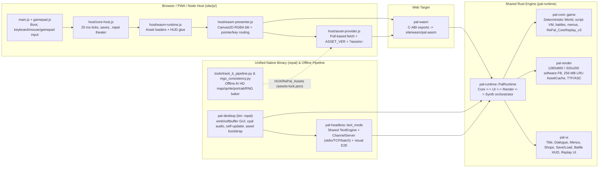

# PalRemake (RePal) Architecture & Design Specification

**RePal (PalRemake)** is a 100% pure-static, zero-backend 4× HD remake of the 1995 DOS RPG *Chinese Paladin* (`仙剑奇侠传`). All world rendering, battle rendering, 1995 DOS UI, collision/pathfinding, deterministic replay recording, and dual-mode audio synthesis share one Rust runtime (`pal-runtime` = `pal-core` + `pal-render` + `pal-ui`) compiled into both:
- **`site/wasm/pal.wasm`** (~1.2 MB) for the pure-static browser / PWA / TV Gamepad web runtime, and
- **`repal` / `repal.exe`** (unified native binary from `pal-desktop` + `pal-headless`) supporting Desktop GUI, Headless Text Mode (`--text`), and Live GUI+Text Mode (`--gui --text` / `--listen`).

---

## 1. High-Level System Architecture

### Design Principles

1. **100% Pure Static Web Runtime (`site/`)**: Zero runtime server and zero runtime AI calls. Everything is served as static files (`.html`, `.js`, `.css`, `.wasm`, `.webp`, `.json`, `.yaml`, `.bin`, `.mid`, `.wav`, `.ttf`) using relative URLs (`./...`) so GitHub Pages subpath hosting (`/RePal/`) works out of the box.
2. **Single Source of Truth**: Game state lives only in `pal_core::game::World`; `pal-runtime::PalRuntime` wires `pal-core`, `pal-render`, and `pal-ui` once and is shared identically by Web WASM (`pal-wasm`), native GUI (`repal`), and headless Text Mode / visual E2E (`repal --text` / `pal-headless`).
3. **Unified Native Binary (`repal`)**: Desktop GUI, Headless Text Mode (`--text`), and Live GUI+Text Mode (`--gui --text` / `--listen`) execute on **one shared `TextEngine` + `ChannelServer`** (see [`docs/TEXT_MODE_SPEC.md`](TEXT_MODE_SPEC.md)), with strict lazy rendering in headless mode.
4. **Instant Live `[Tab]` Dual-Mode Parity**: Switching between **`4× HD (1280×800)` + acoustic reverb synth** and **`1× 1995 Retro (320×200)` + OPL2 FM synth** is atomic and lossless across exploration maps, sprites, RNG cutscenes, battles, and audio.
5. **Pull-Based Bounded Memory (`AssetCache`)**: Instead of eagerly preloading hundreds of scenes, `pal-render` emits missing-asset requests each frame (`wasm_pop_asset_request`). `WasmAssetProvider` (or `pal_runtime::disk::pump_render_assets_from_dir` natively) loads only what the camera touches, `AssetCache` enforces a strict **256 MB** RGBA LRU budget, `permanent_missing` prevents 404 retry storms on un-remastered maps, and `wasm_scratch` shrinks back to `256 KiB` after large asset uploads (`> 4 MiB`).
6. **Trilingual i18n, Unified `ReplayPlayer` & HD AI Subtitles**: Live switching across Simplified Chinese, Traditional Chinese, and English (`data/i18n/en/*.json`), plus segmented `.repal` (`.tar.gz`, `RePal_CoreReplay_v3`) deterministic replay archives played by a single shared **`pal_runtime::replay_player::ReplayPlayer`** across Desktop, Web WASM, Headless `core-replay`, and CI `verify_repal`. Debug mutations are gated by explicit `debug_mode: bool` (rendering a `DEBUG ENABLED` watermark and recording deterministic `ReplayEvent::Debug` events while staying no-ops when `debug_mode == false`), and optional AI thought commentary (`think`) lives in a separate per-segment `annotations.json` track (4× HD present-time overlay, `F7` toggle, exportable via `--replay-export-srt`).

---

## 2. World, Track-B HD Map & Battle Rendering (`pal-render`)

### 2.1 Exploration Map Streaming (Track-B HD vs. 1× Retro)
When `hd_mode == true`, `pal-render` checks `graphics/maps_hd/map_XXX/meta.json` (`AssetKind::HdMapMeta`):
- **Pending `meta.json`**: Skips eager loading of the 45 MB `gop_XXX_4x.webp` fallback while `meta.json` is in flight, avoiding transient memory spikes on HD maps.
- **Track-B HD Map Loaded (`maps_hd/map_XXX/`)**:
  1. **Viewport-Culled Room Chunks**: Only `rooms[]` whose world bounds intersect `[view_x .. view_x + 320, view_y .. view_y + 200]` are requested and blitted `1:1` (`<= 2048×2048` HD WebP per chunk).
  2. **Spatially Paginated Occluders (`<= 2048×2048` per page)**: Foreground occlusion strips are partitioned into `512×512` logical (`2048×2048` HD) map quadrants (`occ_r{row}_c{col}_p{idx}_4x.webp`) so even massive outdoor maps (`Map 055`, previously a single `12288×5728` = `281.5 MB` RGBA monolith) stream only the 1–4 quadrant pages currently visible on screen (peak worst-case 4-quadrant corner footprint: `182.7 MB`, every texture `<= 16 MB` RGBA).
  3. **Painter's-Exact Y-Sorting**: Visible occluder strips (`sort_y`) and `MGO` character/prop sprites (`sort_y`) merge into one Y-sorted depth queue. Characters marked `"shadowStripped": true` in `mgo_XXX.json` receive a smooth anti-aliased multi-ring elliptical ground shadow (`draw_soft_ellipse_shadow`).
- **Retro Mode (`[Tab]`) or Un-Remastered Map (`meta.json` 404 -> `permanent_missing`)**: Renders directly from `map_XXX.bin` + `gop_XXX_1x.webp` (1×) or `gop_XXX_4x.webp` (4× fallback).

### 2.2 Full Feature Parity in `pal-render` + `pal-wasm`
- **RNG Cutscenes (`playRngCutscene`)**: Renders `graphics/rng/rng_XX/f_XXX_{4x,1x}.webp` fullscreen inside the framebuffer with live `[Tab]` switching mid-cutscene.
- **Camera & Screen Effects**: `camOverride`, earthquake `shakeOffset`, custom `fadeColor` RGBA (`#000000`, `#FFFFFF`, red flash, etc.), `nightPalette` tinting, and click-to-walk ground ripples (`stroke_ellipse`).
- **Battle Rendering**: `fbp` battle backdrops, hero/enemy `f_XXX` / `abc_XXX` sprites with attack lunge offsets, `fire_XXX` spell VFX overlays, and floating damage/heal numbers rendered via `FontEngine`.
- **Fast Integer `1:1` Blitter**: `Framebuffer::blit_region_scaled` takes a direct memcpy/alpha fast path when `sw == dw && sh == dh && alpha_mul == 255`, and `RenderEngine::render_frame` skips the `4 MB` UI composite pass whenever `ui_layer` has no pixels.

---

## 3. Deterministic Game Core (`crates/pal-core/src/game/`)

All game logic and state live in Rust; JavaScript contains none.

- **Single source of truth**: `World` (`game/world.rs`) holds everything a save contains, including the RNG state. Rendering and UI read `state::GameState`, a projection written once per tick by `Game::project_render_state` — there are no per-field JS↔WASM sync calls.
- **Script program** (`script.rs`): decompiled YAML steps are re-assembled into original `SCRIPTENTRY` operands (opcode table generated from `tools/pal_pipeline/decompiler.py`). Chapters and mod overrides are loaded as JSON by the host; jump targets are interned labels resolved at run time.
- **Script VM** (`game/vm.rs`): every opcode of the original game. Foreground scripts are resumable state machines: dialogue, choices, shops, battles, fades, walks and asset loads are explicit `Wait` states. Background (auto) scripts run synchronously once per auto tick.
- **Time & randomness**: `Game::tick` is one fixed 20 ms logic step (player step every 4 ticks, auto scripts every 6). The core never reads a clock or a platform RNG — every random draw comes from `World::rng` (Mulberry32). Ticks spent waiting for the host to load assets or play a cutscene do not count, so a replay of `(tick, input)` pairs from the same seed reproduces the exact state (`site/js/host/core-host.js`, `F9`).
- **Battles** (`game/battle.rs`), **menus** (`game/menu.rs`), **exploration & triggers** (`game/explore.rs`, using the DOS diamond metrics below) and **saves** (`game/save.rs`, legacy-compatible JSON + DOS `.rpg`).
- **DOS PAL Isometric Diamond Trigger Metric**:
  - Proximity (`trigger_mode >= 4`): `|ev.x - lead.x| + |ev.y - lead.y| * 2 < (trigger_mode - 4) * 32 + 16`.
  - Search (`trigger_mode` `1..3` around `probe = lead + step(dir)`): `|ev.x - probeX| + |ev.y - probeY| * 2 < (trigger_mode - 1) * 32 + 16`.
- **Host interface**: the core emits `HostCmd`s (music, sfx, load scene/chapter, RNG cutscene, title, game over); `pal-runtime::PalRuntime::route_cmds` turns UI-facing ones (dialogue, choices, shops, battle HUD, toasts) into `pal-ui` state directly and queues the rest for the active host (`pal-wasm`, `pal-desktop`, or `pal-headless`).

---

## 4. Verification & CI Matrix (`.github/workflows/ci.yml`)

| Layer | Suite | Coverage |
|---|---|---|
| Game core | `cargo test -p pal-core` | Script assembly of all 4262 blocks, native new-game intro, deterministic battles, menu actions, save round-trip, all 51 DOS `.rpg` saves, parity scenarios vs `tools/parity/golden/` (Chapter 1 inn, 13 checkpoints recorded from the retired JS runtime), NPC/monster/item/story regressions (`tests/regressions_*.rs`) |
| Render/UI & visual E2E | `cargo test --workspace` | `pal-render`, `pal-ui`, `pal-headless` visual E2E |
| WASM build | `make build-wasm` | `site/wasm/pal.wasm` stays `< 1.5 MB` |
| Browser host | `node tools/test_rust_core_host.mjs` | Real site booted headless: title → intro through `pal-ui` (matches golden), walking, frame-exact replay, save/load, battle via the HUD |
| Host regressions | `node tools/tests/test_host.mjs` | Audio unlock/dedup, YAML prototype-pollution guard, blur, letterbox `clientToWorld`, clipboard |
| Static & Track-B | `pytest tools/tests/` | Static purity, `< 50 MB` files, relative URLs, YAML integrity, occluder caps |

---

## 5. Decoupled Asset Hosting (`HclX/RePal_Assets` & `assets-lock.json`)

Static game assets (`site/assets`, gitignored in the code repo) are decoupled into **`HclX/RePal_Assets`** and SHA-256 pinned via [`assets-lock.json`](../assets-lock.json):
- **Local dev**: symlink `site/assets -> ../../RePal_Assets/assets` (or unpack `DoSPal.zip` via `pal-cli`).
- **Encrypted packs (`tools/build_asset_packs.py`)**: assets ship as `.rpk` packs described by `pack-manifest.json` — one **base** pack (data, i18n, UI, fonts, title, engine-required FBPs; split into category-stable shards such as `base-data`) plus one pack per **chapter** (derived from scene requirements). `build_asset_packs.py check` (run in CI) verifies every scene's assets land in base or its chapter pack.
  - **Deterministic content keys**: each pack's key is `HMAC(master, pack_id + content digest)`, so unchanged content produces byte-identical packs across releases and clients only re-download packs that changed.
  - **Passphrase unlock**: `master_key_wraps` in the manifest wraps the master key with PBKDF2-SHA256 (600k iterations); clients accept either the passphrase or the 64-hex master key (`pal_runtime::pack_vfs::resolve_pack_key_input`, `site/js/host/pack-manager.js`).
  - **Publishing**: the `publish-packs.yml` workflow builds and uploads a `packs-vN` release and bumps `assets-lock.json`; manifests are fetched from raw.githubusercontent.com first, with jsDelivr as fallback (jsDelivr's GitHub proxy rejects files over 50 MB).
- **Native `repal` binary**: `assets_bootstrap.rs` fetches the pinned manifest, downloads and verifies the base pack at the splash screen, and caches packs under `<user_data>/assets_cache/packs/` (with persisted verification stamps, so warm launches skip re-hashing). Chapter packs download asynchronously on scene load behind a loading overlay (`pack_download.rs`); **Download All** fetches the rest for offline play.
- **Web**: `pack-manager.js` mirrors the same flow (IndexedDB cache, `navigator.storage.persist()`, passphrase dialog, Download All).
- **CI & GitHub Pages**: workflows fetch and verify the pinned asset pack via `assets-lock.json` before running asset-dependent Rust/Node/Python suites.
- **External CDN override (Web)**: `site/js/host/asset-provider.js` (`resolveAssetBaseUrl()`) supports overriding the asset origin via **`window.PAL_ASSET_BASE_URL`** or query parameter **`?assets=<base_url>`** while defaulting to `./assets`.

### Storage Footprint Reference (at 58 / 221 HD Maps)
| Directory | Size | Notes |
|---|---:|---|
| `assets/graphics/maps_hd/` | `262 MB` | 58 / 221 Track-B HD maps (~4.5 MB/map average) |
| `assets/graphics/rng/` | `80 MB` | 12 RNG cutscenes (4× + 1×) |
| `assets/graphics/mgo/` | `38 MB` | 637 MGO character/prop atlases (4× + 1×) |
| `assets/graphics/gop/` | `34 MB` | 226 GOP tile atlases (4× + 1×) |
| `assets/audio/` | `11 MB` | MIDI BGM + 16-bit WAV SFX |
| `assets/graphics/fbp/`, `data/`, `fonts/`, other | `57 MB` | Backdrops, YAML tables/scripts, i18n, fonts, 51 `.rpg` saves |
| **Total `assets/`** | **`~482 MB`** | Scales to **~1.2–1.3 GB** at 221 / 221 HD maps (CDN/R2 optional for Web scaling) |
